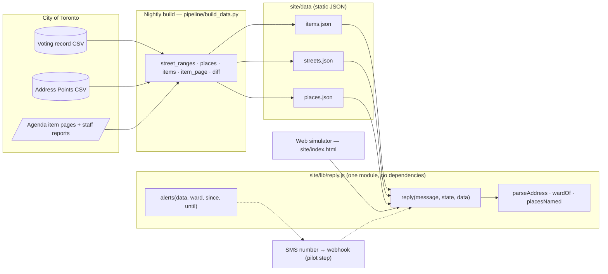
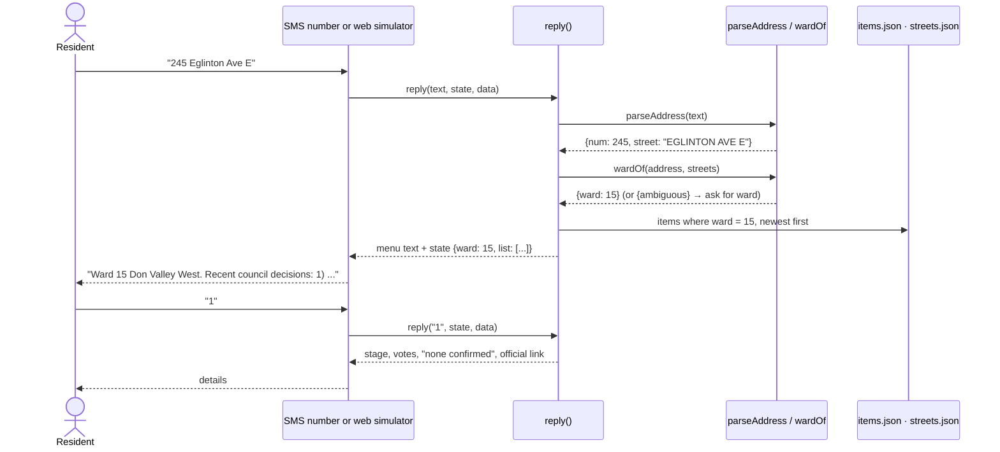
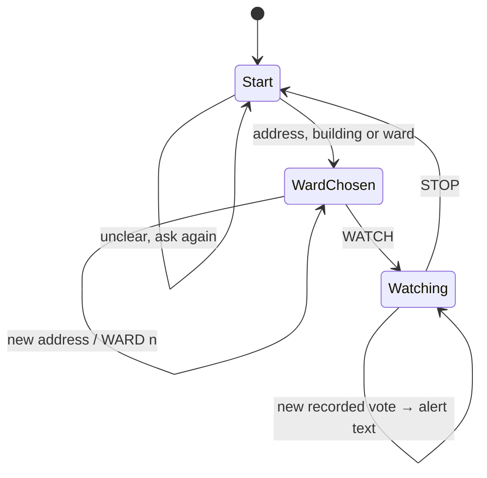
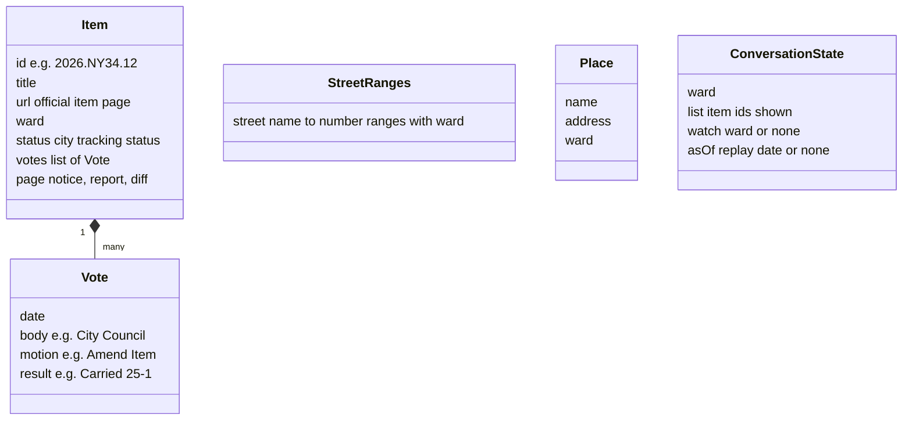

# Text City Hall — software design

How the system is built, why, and how each requirement is checked. Function and file names match the code.

## 1. Requirements

Each requirement is testable; the right column says where it's checked (`node --test tests/*.test.js` runs on every push).

### Functional

| ID | Requirement | Checked by |
|---|---|---|
| F1 | A resident texts a Toronto street address and gets the ward and its most recent council decisions (max 3). | test *address -> menu -> details* |
| F2 | A building name ("CN Tower") resolves to its official address and ward; a name matching places in different wards lists them and asks for the address. | test *building names resolve…* |
| F3 | `WARD n` (1–25) lists that ward's decisions. | test *every item detail fits…* |
| F4 | Replying with a list number gives the item's stage, recorded votes (body, motion, result, date) and the official item link. | test *address -> menu -> details* |
| F5 | `WATCH` subscribes to the current ward; a new recorded vote for an item there produces an alert text. | tests *commands*, *alerts list votes in the window only* |
| F6 | `STOP` unsubscribes; `HELP` explains the service. | test *commands* |
| F7 | The records can be viewed as of a past date; the view is labelled as a replay. | test *dated replay hides later votes…* |
| F8 | The pipeline rebuilds all data from City of Toronto sources in one command. | `pipeline/build_data.py` asserts (below) |

### Non-functional

| ID | Requirement | Checked by |
|---|---|---|
| N1 | **Never a wrong ward.** Unknown → ask; near a boundary → ask for the ward. | test on 2,000 random real addresses: 1,989 correct, 11 asked, 0 wrong |
| N2 | **Never a guessed deadline.** No comment deadline unless an official page confirms it. | test asserts "none confirmed" |
| N3 | **Every claim sourced.** Every item reply ends with its official link; decision text is word for word from the record. | test *ends with its official link*; pipeline asserts every extracted line appears in the source |
| N4 | Every reply fits 3 SMS segments (≤ 459 GSM-7 characters). | test checks every item in all 25 wards |
| N5 | Privacy: addresses are never stored; WATCH keeps only phone number and ward. | `reply()` state holds only `ward`, `list`, `watch`, `asOf` |
| N6 | Accessible web page: keyboard focus, live region for replies, legible type, works at phone width. | manual check, Playwright screenshots |
| N7 | Runs with no server or database; free to host. | deployed as static files on GitHub Pages |

## 2. UML

### Component diagram

### Sequence: a resident texts an address

### Conversation states

### Data model

## 3. Architecture rationale

| Decision | Alternatives considered | Why this one |
|---|---|---|
| **Deterministic replies from records** | An AI model summarizing agendas | The brief: "a summary that mis-states a decision is worse than no summary". Fixed templates over city fields can't invent facts, and a clerk can review every template once. |
| **One `reply()` module for every channel** | Separate SMS bot and web app | The judges' simulator and a real phone run identical code, so what was tested is what residents get. A new channel is a thin adapter. |
| **Static JSON + nightly build, no server or database** | API server + database | Council data changes at most daily. Static files cost nothing to host, can't go down under load, and have no database to secure. |
| **Address Points, not postal codes** | Postal code → ward | Postal-code areas cross ward lines, which would give wrong wards. The city's address file lists each address's ward. |
| **Street ranges per side of street (odd/even)** | Shipping all 525,168 addresses | 0.39 MB for the whole city (131 KB compressed) instead of tens of MB, and boundaries that run down the middle of a street stay correct. |
| **Refuse rather than guess** (boundary, unknown street, duplicate building names, deadlines) | Nearest match | Misleading a resident is worse than one extra text. |

**Maintainability and testability.** `reply()` is a pure function of (message, state, data): no network, no clock, so every behaviour is a one-line test. The pipeline asserts its own outputs (25 wards found, every extracted decision line present word for word in the source PDF), and fails the build rather than publish bad data.

## 4. Scalability

- **More residents.** The web page is static files on a CDN. For SMS, each text is one call to a small stateless function; conversation state travels with the message, so instances scale horizontally. The practical limit is carrier throughput per number; a city adds numbers or a short code as volume grows.
- **More data.** The whole city's address index is 0.39 MB and loads once. Items grow by about a few hundred a year per city; at 10× that, a ward-split file per ward keeps each download small.
- **More cities.** Only `pipeline/build_data.py`'s data step is city-specific (where the vote and address files come from and their column names). Everything after it is the same.
- **Bottlenecks to watch.** The nightly build downloads a 183 MB address CSV; it only needs to rerun when the city republishes it. Alert sending is bounded by SMS rate limits, so alerts are queued per ward.

## 5. Code walkthrough

| File | What it does |
|---|---|
| `pipeline/build_data.py` | Downloads the open datasets (cached), builds `streets.json` (`street_ranges`), `places.json` (`places`), `items.json` (`items`, plus `item_page` for saved agenda pages, which extracts the tracking status, ward and council decision, fetches the linked staff report, and `diff` pairs staff recommendations with council decisions word by word). Writes a 2,000-address test sample. |
| `site/lib/reply.js` | `parseAddress` normalizes "245 Eglinton Avenue East" to the city's street names. `wardOf` finds the range containing the number on the correct side of the street, and returns `{ambiguous}` when ranges disagree. `placesNamed` matches building names by whole words. `reply` is the conversation. `alerts` lists votes recorded in a date window. `kind` maps title words to plain labels (whole words only). |
| `site/index.html` | The web phone simulator: loads the three JSON files, calls `reply`, shows texts, and the replay date control. |
| `tests/reply.test.js` | 10 tests, including 2,000 real addresses and every item in all 25 wards. |
| `.github/workflows/pages.yml` | On every push: run the tests, then publish `site/` to GitHub Pages. |
| `video/` | Demo video: `record-demo.cjs` records the live site, `tts.cjs` generates the narration, `src/Composition.tsx` assembles it. |

### How AI assistance was used and verified

Claude Code (Anthropic) helped write the pipeline, `reply.js`, the tests, the web page and the video tooling. Every behaviour above is covered by tests that run on each push; facts in the video and report were checked against the source records by script (vote counts, page counts, ward lookups). Two bugs found this way and fixed: "191-199" losing its hyphen in PDF extraction, and "701 Fleet Street" being labelled a tree removal because "Street" contains "tree" (labels now match whole words). ElevenLabs (voice Chris, model eleven_v3) generated the video voice-over from our script. The Sam character is hand-coded SVG (`video/src/Sam.tsx`), no image generation.
